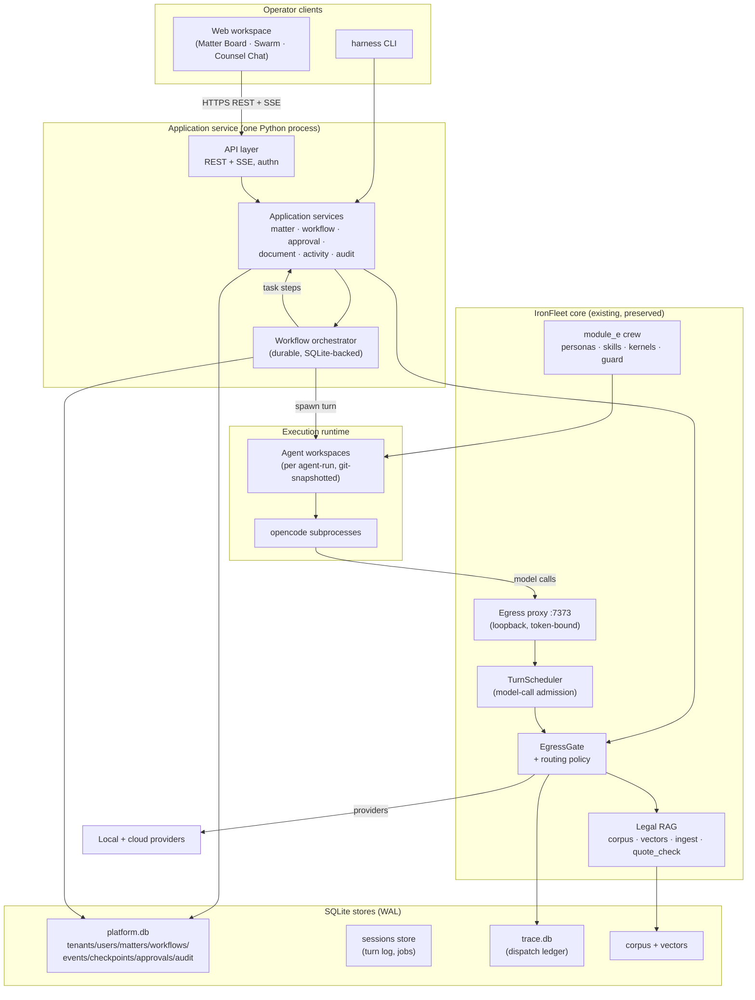
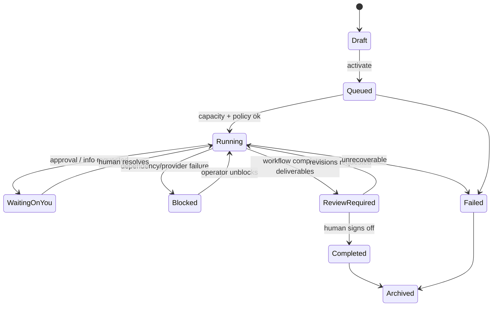
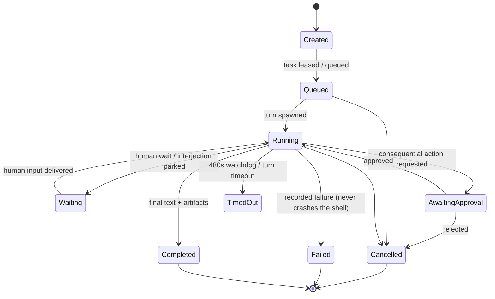
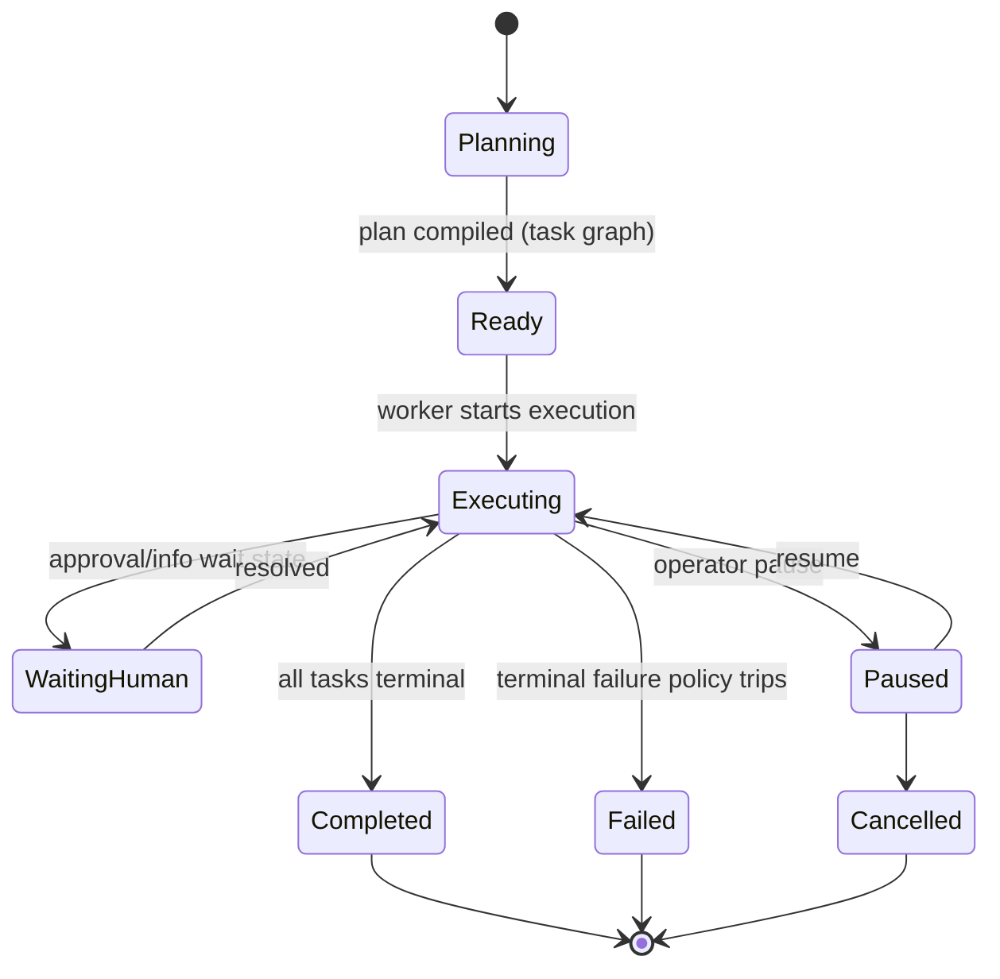

# 02 — Target Architecture

**Date:** 2026-11-04 · **Status:** proposal awaiting owner approval · **Companion to:** [01-repository-audit.md](01-repository-audit.md) (evidence base; section refs "§N" point there).

## 0. What forces this shape

Five audit facts drive every decision below:

1. **The IronFleet core is sound and stays.** Gate, routing policy, capacity, providers, workspaces, RAG engines, eval harness all classify KEEP/EXTEND (§11). Nothing here rewrites them.
2. **There is no durable execution layer** (§3.3, §4): the scheduler is an in-process admission controller for *model calls*; a crashed run leaves orphan state and cannot resume. This is the biggest genuine gap and gets the biggest new component.
3. **There is no API and no approval mechanism** (§9, S8): every surface today is a process reading SQLite in-place. An enterprise workspace is impossible without both.
4. **Two confidentiality holes are model-reachable** (S1, S2): they are fixed *before* any new surface exists.
5. **Production logic lives in `scripts/` and `spike/`** (§12.1), and ~300 lines of backend logic are trapped in the TUI class (§8). Both block the target packaging and must be relocated/extracted before surfaces are built.

## 1. Architecture at a glance



**Process model:** one host machine, one service process hosting the API + application services + orchestrator + gate + scheduler + egress proxy (two listeners: model proxy on loopback :7373 as today, API on a second loopback or TLS port). The egress proxy is *only* the model-traffic funnel for opencode subprocesses; humans never talk to it. This preserves the proven threading pattern (threaded HTTP front → `run_coroutine_threadsafe` → one asyncio loop, `egress_proxy.py:22-52`) and avoids a service-mesh for a single-box system.

**Multi-user posture:** the data model carries tenant/user/role from day one (03), and the API enforces authentication from its first commit — but the deployment is single-tenant, small-team. No distributed worker fabric is introduced; if a second machine is ever needed, the workflow store's task-lease design (§7) is what makes that possible, not a new platform.

## 2. Service boundaries

All boundaries are **in-process module boundaries** (principle 12: no abstraction without an identified requirement). Dependency direction is strictly downward; nothing below calls anything above.

| Layer | Module | Owns | Must not |
|---|---|---|---|
| API | `harness/api/` | HTTP/SSE transport, authn, request validation, serialization | contain business rules |
| Application services | `harness/service/` | use-cases: create matter, dispatch task, approve, ingest; permission checks; emitting events | touch HTTP or subprocesses |
| Workflow | `harness/workflow/` | durable state machine, task leases, checkpoints, recovery, event store | know about personas or prompts |
| Core (existing) | `harness/` gate, scheduler, providers, session, module_e, corpus… | model dispatch, turn execution, RAG, guard | depend on workflow/service/API |

The application-service layer is where the ~300 lines trapped in `IronFleetApp` land (§8): `/ingest` wiring, `/doctor`, `/persona new`, dispatch-with-compact policy, session digest — extracted as callable use-cases, first consumed by the CLI, later by the API. The TUI keeps working during migration by calling the same services.

## 3. Domain model (summary)

Full entity catalog in [03-data-model.md](03-data-model.md). The spine:

**Matter** (tenant-scoped legal workspace) → **Workflow** (a runnable plan, e.g. the legal pipeline) → **WorkflowExecution** (one durable run) → **AgentRun** (one agent's work inside an execution; wraps today's turn) → **Task** (unit of schedulable work, leased to a worker) with **Checkpoint** rows; **Artifact** (deliverables), **Evidence** (retrieved/verified sources), **Approval** (human gate), **Conversation** (counsel chat), **AuditEvent** (tamper-evident log). Existing stores persist unchanged: `sessions/` (turn log), `trace.db` (dispatch ledger), corpus/vectors.

## 4. Matter lifecycle

States from the brief §3.1, enforced as a validated state machine (today's status strings are free text — §12.7 — so transitions become code, not convention):



- `Waiting on you` is a **first-class persisted state**, not a UI inference: it exists because a workflow is parked on an `Approval` or `Request` row (03 §Approval), and the Matter Board reads it from the database.
- Concurrent executions per matter are allowed (parallel branches, §7); the matter state is derived from its executions' states (any waiting → WaitingOnYou; else any running → Running; …). The derivation is a service function, tested, not scattered logic.
- Replaces today's `matter.json` (egress_proxy.py:90-116) as the authority; the proxy reads a matter record from `platform.db` instead, including its classification and access policy — which also closes S6 (classification hardcoded in the TUI).

## 5. Agent lifecycle

Agent states (brief §3.2) mapped onto the pieces that already exist:



- `AgentRun` is the durable identity of what is today an ephemeral turn (§3.1): it records persona snapshot, model task-class, parent AgentRun (delegation), workspace path, trace refs, token totals, error ledger. `spawn_agent` children become visible rows (fixes the invisibility found in §3.1 delegation).
- `Cancelled` is honest: the driver gains a kill-on-abandon seam (EXTEND, §11.2) so cancellation tree-kills the subprocess instead of abandoning it (§3.2).
- The personas/kernels/skills systems are unchanged; an AgentRun stores a *snapshot* of the persona file it ran with, so history survives persona edits.

## 6. Workflow lifecycle

A **Workflow** is data: today's `legal_pipeline.yaml` shape (stages, agents, instructions) generalized with dependencies and approval points. Same execution foundation serves different practice areas by different workflow documents (brief §5) — no per-domain engine.



- **Compiling a plan.** Stage list + dependency edges + approval points compiled from the workflow definition (extend `factory.py`'s plan grammar — plan blocks, legal pipeline fallback — kept verbatim as the default definition).
- **Executing.** Tasks with no unfinished dependencies are leaseable. Execution = the proven `_run_stage` unit (EXTEND, §11.2) driven by the orchestrator instead of a for-loop. Failure policy becomes per-workflow data (default for legal work: **halt and mark Blocked/Waiting** rather than today's silent continue-on-failure, §3.1 — downstream advice must not draft on missing research).
- **Durable waits.** A wait state is a row in `platform.db`; the process can die and restart without losing it. This is the capability that makes days-long work and `Waiting on you` real (§3.3 finding: workflows cannot wait today).

## 7. Durable execution design (the critical question, answered)

Brief §7 asks whether the current scheduler is genuinely durable. It is not (§4) — and it should **not** be stretched into it. The target:

| Concern | Mechanism |
|---|---|
| Workflow/task state | `workflow_*` tables in `platform.db` (WAL); the single source of truth |
| Task scheduling | Orchestrator claims ready tasks with a **lease** (task row: `leased_by`, `lease_expires_at`); a crashed worker's lease expires and the task is re-queued — this is what later permits a second worker process without a queue server |
| Model-call admission | Existing `TurnScheduler` unchanged: per-matter lock + global semaphore stays as the concurrency governor at the proxy (§11.1: EXTEND only for `run_timeout` and a per-matter budget) |
| Checkpoints | `Checkpoint` rows + workspace git snapshots (already per-stage, workspace.py) — resume = re-drive from the last terminal task; completed tasks are never re-executed (idempotency by state, fixing §3.3 "re-run never refreshes" via content-addressed artifact copy) |
| Events | `workflow_events` append-only table (§8); API fans them out over SSE |
| Recovery | On service start: reconcile `running` executions (crashed = lease expired) → mark failed-or-resumable; close orphan `running` jobs (the gap §5 found) |
| Retry semantics | Spawn-level: keep the one code-124 retry (workspace.py:128-132); task-level: retry policy per workflow node (default: no auto-retry for legal stages, alert instead) |
| Timeouts | `run_timeout` wired into TurnScheduler (bootstrap.py:100, egress_proxy.py:303); turn watchdogs unchanged |
| Human waits | Execution parked on an Approval/Request row; resumption is a service call that re-leases the task |

**Explicitly rejected for now:** Temporal/Celery/Redis/a job server. Principle 11 (no premature technology selection) and principle 12 (no unnecessary complexity): a single-host SQLite lease design meets every stated requirement and keeps the stack one language and one file format. If a second machine ever becomes real, the lease table migrates to Postgres without changing the orchestrator's logic.

## 8. Event architecture

Two event streams with different jobs:

1. **Execution events** (new): `workflow_events` — append-only, ordered `(execution_id, seq)`, typed (`task.started`, `turn.completed`, `tool.denied`, `guard.annotated`, `approval.requested`, `matter.state_changed`, …), each carrying actor (human/agent id), matter, correlation ids. Written by services/orchestrator in the same transaction as the state change. The API tails them for SSE; the Activity timeline and Audit views read them.
2. **Model-dispatch ledger** (existing): `trace.db` stays the per-call provenance record (KEEP, §11.1); attribution moves from UPDATE (trace.py:123-136) to append-only event writes, and dispatches mirror into the audit chain for tamper-evidence.

No embedded message broker. SSE from the single process is sufficient for the operator count in scope (brief §16 performance: incremental updates, no full refreshes — SSE per-matter channels deliver exactly that).

## 9. Data flow: one user task, end to end

```mermaid
sequenceDiagram
    participant L as Lawyer (web)
    participant A as API
    participant S as Matter service
    participant O as Orchestrator
    participant D as Driver + workspace
    participant P as Proxy→Scheduler→Gate
    participant G as Guard / RAG

    L->>A: POST /matters/{id}/tasks ("run full pipeline")
    A->>S: dispatch_task(use-case)
    S->>S: maybe compact; compile plan (legal pipeline)
    S->>O: create WorkflowExecution + tasks
    O->>D: lease task: intake/ingestor
    D->>D: sync workspace, write stage agent md, handoff copies
    D->>P: opencode turn (model calls)
    P->>G: dispatch → provider (trace row)
    G-->>D: response; guard annotates; corpus tool enforces bound matter
    D-->>O: turn row + artifacts
    O->>O: checkpoint; release lease; next ready task(s)
    O->>A: workflow_events → SSE push
    A-->>L: live swarm/timeline updates
    O->>S: filings stage requests approval
    S->>S: execution → WaitingOnYou; Approval row
    A-->>L: "Waiting on you" on Matter Board
    L->>A: POST /approvals/{id}:approve
    S-->>O: resolve wait; re-lease task
```

## 10. Persistence architecture

| Store | Status in target | Notes |
|---|---|---|
| `platform.db` (new) | Created in Phase 3–5 | tenants, users, roles, matters, workflows, executions, tasks, events, checkpoints, approvals, conversations, audit. WAL, busy_timeout |
| `sessions/` (existing) | KEEP + EXTEND | stays the turn log and opencode resume handles; gains WAL + reconciliation (§11.2) |
| `trace.db` (existing) | KEEP + EXTEND | dispatch ledger; append-only attribution; mirrored into audit chain |
| `corpus.sqlite3` / `vectors.sqlite3` | KEEP + EXTEND | gains metadata columns, provenance persistence, version rows (Phase: legal intelligence) |
| `agent_memory.db` | INVESTIGATE (§11.3) | scoping decision owned by the owner; content guard either way |
| Workspaces | KEEP | per-agent-run dirs, git snapshots; live under the store root as today |

All writers use WAL + short transactions; one connection-per-operation as today, plus `busy_timeout` everywhere (today only trace.db sets WAL — §5).

## 11. API architecture

Full contract in [04-api-and-events.md](04-api-and-events.md). Shape: **REST + SSE**. REST for commands and reads (matter/task/artifact/approval CRUD, agent inspection); SSE for live activity (per-matter event channel + a board-level channel). WebSockets are rejected: no bidirectional need exists in any specified interaction — the counsel chat is command/response through the same REST flow — and SSE traverses the proxies a local-first deployment actually sits behind. Framework recommendation and trade-offs (a new dependency, needing approval per §18) live in 04 §2.

## 12. Security architecture

Layered, backend-enforced (principle 7). Each layer closes specific audit findings:

| Layer | Mechanism | Closes |
|---|---|---|
| Model egress | unchanged gate + proxy; **per-run token**: each workspace's mount is bound at sync to a token resolving to exactly one matter; client-supplied matter headers ignored when a token is present | S3 |
| Tool egress | deny-by-default `bash`/`webfetch`/`websearch`/`edit` across all personas; explicit allow-list per persona; MCP integrations may only be added **through** the gate (any MCP surface that cannot preserve isolation is a documented blocker, brief §10) | S2 |
| Corpus boundary | matter tool-argument removed; tool reads only the workspace-bound matter | S1 |
| Guard | logic relocated out of `spike/`; authority files and guard log owned by the harness outside the agent workspace; append-only log; `block` mode default for verify/filings stages, configurable per matter policy | S4, part of S7 |
| Memory | canon content check refusing matter identifiers; scoping per owner decision | S5 |
| API authn/authz | every API request authenticated; RBAC enforced in services; matter access policy rows consulted for every cross-matter capability | S8 groundwork, brief §10 |
| Human approval | `Approval` rows as durable workflow gates; consequential action classes (filings, external comms, final opinions, strategy changes) configured per workflow/matter policy | S8, brief §9 |
| Audit | `audit_events` hash-chained, append-only; covers auth events, approvals, guard blocks, dispatch summaries; trace.db mirrored in | S7, brief §9 |
| Secrets | unchanged OS-keychain pattern; `IRONFLEET_*_URL` overrides validated against a scheme/host allow-list | S9 |

Classification of a matter remains **policy data** (matter record), never a UI default (S6).

## 13. Frontend architecture

The TUI is retired (§11.5) once its trapped logic is extracted (§8) and the web workspace reaches parity for daily operations. The web client is a **thin client over the API** (principle 9): no direct SQLite access, no in-process coupling.

Two buildable options, decision owned by the owner (per the standing UI-feedback rule: designs are confirmed before any screen is built):

- **Option A (recommended): small React SPA** (Vite + TypeScript) served statically by the API process, one dependency surface, component model well suited to the swarm graph (SVG/Canvas) and dense tables. Cost: a Node build toolchain.
- **Option B: server-rendered HTML + htmx islands.** Far less code, no build chain, excellent for tables/timelines/approvals; weaker for the interactive swarm graph, which would need a bespoke JS component anyway.

Either way: keyboard-first interactions retained where they made the TUI good (copy, command palette), dark professional theme, information-dense tables (the TUI's agent/jobs panes are the information model to carry forward — §11.5 preservation list).

## 14. Observability

Builds on what exists rather than adding a stack:

- **Structured events:** `workflow_events` is the machine-readable activity log (correlation ids: matter, execution, task, agent_run, trace).
- **Dispatch telemetry:** trace.db already carries provider/model/tokens/latency/status per call (trace.py:42-48); surfaced per agent-run via the API (the TUI's token meter generalized).
- **Errors:** `errors.jsonl` pattern retained per component, indexed into the event store as `error.*` events.
- **Health:** `/healthz` (process, stores reachable, proxy bound, provider probe status from the existing probe machinery).
- **Provider latency / retry visibility:** derived queries over trace.db (the eval harness already reads it this way).

No Prometheus/Grafana/OTel in scope; the JSON event stream is importable later if the deployment ever grows (principle 11).

## 15. Deployment considerations

- **Single box, single service.** Windows-first (today's platform), macOS second (macdist already pins opencode; `packaging/` EXTENDs to a non-editable install once `scripts/`/`spike/` substrate relocates into `src/` — §12.1).
- **Storage layout unchanged** at `resolve_store_root()`; `platform.db` joins the family. Backups = copy the store root (existing `p07_register_backup_windows.ps1` pattern extends).
- **Upgrades:** additive SQLite migrations with the existing ALTER pattern (store.py:72-76); every migration runs inside a transaction with a version row; rollback = restore backup (documented, single-operator scale).
- **Process supervision:** the service runs under the OS service manager (Windows service / launchd); crash → restart → recovery reconciliation (§7) makes restart safe rather than destructive.
- **Configuration:** `providers.yaml`/routing YAML unchanged; matter classification and approval policy move into `platform.db` matter/workflow records.

## 16. Decisions requiring owner approval

1. Approve the **SQLite lease-based durable execution** design over introducing an external workflow engine (§7).
2. Approve the **single-process service** deployment shape (§1).
3. Choose the **frontend stack**: React SPA (recommended) vs htmx (§13).
4. Approve the **API framework** recommendation in 04 §2 (a new dependency; §18 requires sign-off).
5. Approve the **roadmap ordering** in 06 (security before surfaces; durable execution before frontend), which reorders the brief's §15 stages with justification.
6. Rule on **agent-memory scoping** (cross-matter canon: feature or hole, §11.3).
7. Confirm the **failure policy change** (legal pipelines halt on stage failure instead of continuing, §6).
8. Confirm **TUI retirement timing** (06 Phase 2 extraction → Phase 6 parity gate), given the owner's 2026-11-04 direction to remove it.
