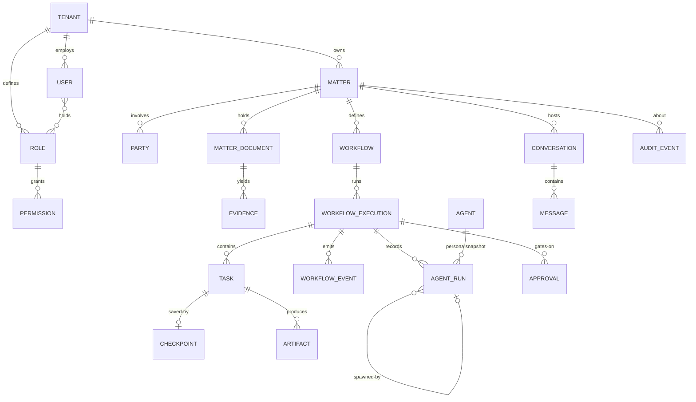

# 03 — Data Model Proposal

**Date:** 2026-11-04 · **Status:** proposal — no migrations are authorized (brief §18) · **Companion to:** [01-repository-audit.md](01-repository-audit.md), [02-target-architecture.md](02-target-architecture.md).

## 0. Scope and ground rules

- This models the **`platform.db`** store (02 §10) plus its relationships to the stores that already exist and stay put: `sessions/` (turn log), `trace.db` (dispatch ledger), `corpus.sqlite3`/`vectors.sqlite3` (RAG), agent workspaces (filesystem + git).
- Existing per-matter tables (`docs_<m>`, `fts_<m>`, `cites_<m>`, vec partitions) keep matter_ref as their join key; nothing here changes their schemas beyond the extensions already recommended in 01 §11.4.
- IDs: text keys (`m-…`, `wf-…`, `run-…`) matching existing conventions (`session_id`, `matter_ref`); timestamps ISO-8601 text as everywhere today. Every table that matters carries `tenant_id` from day one even while deployment is single-tenant — retrofitting tenancy is the expensive path.
- The `matter` concept **absorbs today's `matter.json`** (egress_proxy.py:90-116) and today's implicit "matter = string in a URL".

## 1. Entity relationship overview

## 2. Entities

Format per entity: purpose · key fields · relationships · ownership (which layer writes it) · access boundaries · persistence.

### 2.1 Tenant

- **Purpose:** isolation root. Exists so multi-tenant is a data fact, not a rewrite; today always exactly one.
- **Key fields:** `tenant_id` PK, `name`, `created_at`, `settings_json` (egress defaults, retention policy).
- **Relationships:** owns users, roles, matters.
- **Ownership:** seeded by bootstrap; read by everything.
- **Access:** every tenant-scoped query filters on it; API middleware resolves it from the authenticated user.
- **Persistence:** `platform.db`, immutable id.

### 2.2 User

- **Purpose:** a human principal (lawyer, operator). Today's "operator" is one row.
- **Key fields:** `user_id` PK, `tenant_id` FK, `display_name`, `auth_identity` (local credential hash; external IdP later), `is_active`, `created_at`.
- **Relationships:** holds roles via `user_roles`; issues approvals, comments, conversations.
- **Ownership:** service layer (admin use-cases).
- **Access:** self-read; admin write. Passwords/keys never stored here beyond a salted hash; provider keys remain in the OS keychain (01 §6).
- **Persistence:** `platform.db`.

### 2.3 Role

- **Purpose:** named permission bundle (`admin`, `supervising_partner`, `associate`, `reader`).
- **Key fields:** `role_id` PK, `tenant_id`, `name`, `is_system`.
- **Relationships:** grants permissions; held by users; can be scoped per matter via `matter_members.role_id`.
- **Ownership:** service layer.
- **Access:** admin-only write.
- **Persistence:** `platform.db`.

### 2.4 Permission

- **Purpose:** atomic capability (`matter.read`, `matter.dispatch`, `approval.decide`, `guard.policy.write`, `provider.key.read`, `matter.cross_read` — the last is the explicit, auditable cross-matter capability 01 §6 demands).
- **Key fields:** `permission_id` PK, `key` (unique), `description`.
- **Relationships:** attached to roles.
- **Ownership:** seeded system rows + tenant extras.
- **Access:** enforced only in the service layer, never in API handlers or the frontend.
- **Persistence:** `platform.db` (small, cacheable).

### 2.5 Matter

- **Purpose:** the primary business boundary (principle 3). Absorbs `matter.json` (proxy), the TUI's implicit matter, and the brief §4 metadata list.
- **Key fields:** `matter_id` PK, `tenant_id`, `reference` (human ref), `title`, `client_ref`, `matter_type`, `jurisdiction`, `legal_framework`, `confidentiality` (classification driving gate defaults — kills the S6 hardcode), `access_policy_json` (ethical-wall flags), `state` (validated: draft/queued/running/waiting_on_you/blocked/review_required/completed/failed/archived), `priority`, `objectives`, `deadlines_json`, `lead_agent_persona`, `created_by`, `created_at`, `updated_at`.
- **Relationships:** parties, documents, workflows, conversations, audit events; `matter_members(user_id, role_id)` for assignment; row referenced by every execution.
- **Ownership:** matter service. State transitions only via the state machine (02 §4).
- **Access:** tenant + matter-members + ethical-wall checks in the service layer; the corpus tool binding (S1 fix) keys off this row's id, never a model-supplied argument.
- **Persistence:** `platform.db`; per-matter RAG tables keyed by `matter_id` as today.

### 2.6 Party

- **Purpose:** clients, opposing parties, organizations on a matter (brief §4 "Parties").
- **Key fields:** `party_id` PK, `matter_id` FK, `kind` (client/opposing/court/other), `name`, `role_detail`, `contact_json`.
- **Relationships:** belongs to one matter.
- **Ownership:** matter service.
- **Access:** matter boundary.
- **Persistence:** `platform.db`.

### 2.7 MatterDocument

- **Purpose:** any file on a matter — uploaded source, ingested corpus doc, or generated artifact's immutable original. Unifies what is today scattered: manifest rows (licence/source_url enforced at ingest but **not persisted**, 01 §7), workspace files, deliverable scans (tui.py:295-303).
- **Key fields:** `doc_id` PK, `matter_id`, `origin` (upload/ingest/generated), `source_name`, `source_url`, `licence`, `retrieved_at` (the provenance fields ingest requires but drops — 01 §11.4 fix), `sha256`, `storage_path`, `mime`, `doc_type`, `jurisdiction`, `version` (int, supersede chain via `supersedes_doc_id` — replaces `INSERT OR REPLACE`, corpus.py:247), `ingest_status`, `words`, `chunk_count`, `created_at`.
- **Relationships:** yields evidence; produced-by agent runs (`produced_by_run_id`).
- **Ownership:** document service; the ingest use-case writes it in the same transaction that ingests into corpus/vectors.
- **Access:** matter boundary; downloads via API with authz; agents reach files only through their workspace sync.
- **Persistence:** row in `platform.db`; bytes in the store root's document area; extracted text/chunks remain in corpus tables (join on `doc_id` + `matter_id`).

### 2.8 Evidence

- **Purpose:** a verified, citable unit — retrieved passage, quote verification result, authority record. Makes "evidence-backed" a queryable fact rather than prose (brief §8).
- **Key fields:** `evidence_id` PK, `matter_id`, `doc_id` FK, `kind` (passage/quote/authority/statute-provision), `text`, `locator_json` (section/heading/span), `verified` (bool), `verification` (quote_check result: exact/normalised/failed), `retrieved_by_run_id`, `cited_in_artifact_ids`, `created_at`.
- **Relationships:** from documents; cited by artifacts; produced by runs.
- **Ownership:** RAG/quote-check use-cases; guard annotations may attach `verification=failed`.
- **Access:** matter boundary.
- **Persistence:** `platform.db`; the underlying passages remain in `docs/fts/cites` tables (no duplication of the index, only of the *evidence claim*).

### 2.9 Agent

- **Purpose:** the registry of agent personas (research/hunter, strategy/strategist… today `personas.yaml` + generated `.md` files, 01 §6).
- **Key fields:** `agent_id` PK, `tenant_id`, `name`, `role`, `persona_md` (or pointer to versioned persona file), `tool_policy_json` (the true/false map + denials — deny-by-default after the S2 fix), `default_task_class`, `is_active`.
- **Relationships:** many agent_runs (each snapshots the persona it ran with).
- **Ownership:** persona service (extracted from TUI `/persona new`, 01 §8).
- **Access:** admin/manager write; readers see rosters.
- **Persistence:** `platform.db`; rendered persona files remain the runtime artifact (generated at workspace sync as today).

### 2.10 AgentRun

- **Purpose:** durable identity of one agent's execution — today an ephemeral turn (01 §3.1) plus invisible `spawn_agent` children (01 §3.1 delegation). The join point for everything observable about an agent.
- **Key fields:** `run_id` PK, `execution_id` FK, `task_id` FK (nullable for ad-hoc), `agent_id`, `persona_snapshot`, `parent_run_id` (self-FK for delegation trees), `workspace_path`, `opencode_session` (resume handle, store.py:105), `state` (created/queued/running/waiting/blocked/awaiting_approval/completed/failed/cancelled/timed_out — validated, 02 §5), `model_task_class`, `started_at`, `ended_at`, `tokens_in/out/reasoning/cache` (final totals from trace join), `error_json`, `trace_refs`.
- **Relationships:** belongs to execution+task; parent/child with runs; produces artifacts; generates dispatch rows in trace.db via `session_id`.
- **Ownership:** orchestrator + driver (the driver's rows become AgentRun transitions instead of bare TurnRows; TurnRow JSONL stays as the verbatim log).
- **Access:** matter boundary; the swarm graph and inspection panel read this.
- **Persistence:** `platform.db`; workspace tree + git history unchanged.

### 2.11 Task

- **Purpose:** unit of schedulable work with dependencies and a lease — the row the durable orchestrator claims (02 §7).
- **Key fields:** `task_id` PK, `execution_id`, `seq`, `key` (stage name), `agent_id`, `instruction`, `depends_on` (list of task_ids), `state` (pending/ready/leased/running/waiting/completed/failed/cancelled — validated), `lease_owner`, `lease_expires_at`, `attempts`, `max_attempts`, `timeout_s`, `failure_policy` (halt/skip/continue — workflow-level default), `result_summary`.
- **Relationships:** in one execution; produces artifacts; runs as agent_runs.
- **Ownership:** orchestrator exclusively (lease transitions).
- **Access:** matter boundary via its execution.
- **Persistence:** `platform.db`. This is the table that fixes the orphan-`running` problem (01 §5): a `leased` row with an expired lease is reconcilable state.

### 2.12 Workflow

- **Purpose:** versioned definition — stages, dependencies, approval points, failure policy, per-domain variants (brief §5). Today's `legal_pipeline.yaml` + plan-block grammar (factory.py:59-122), generalized.
- **Key fields:** `workflow_id` PK, `tenant_id`, `name`, `version`, `definition_json` (nodes/edges/approval points), `default_failure_policy`, `is_default` (the legal pipeline), `created_at`.
- **Relationships:** many executions.
- **Ownership:** workflow service; compiled plans cached per execution.
- **Access:** tenant read; admin write.
- **Persistence:** `platform.db`; YAML import remains the authoring format (pipeline-as-data is kept, 01 §11.2).

### 2.13 WorkflowExecution

- **Purpose:** one durable run of a workflow on a matter — the thing that survives restarts (01 §3.3 "no recovery").
- **Key fields:** `execution_id` PK, `workflow_id`, `matter_id`, `trigger` (user/dispatch/schedule), `state` (planning/ready/executing/waiting_human/paused/completed/failed/cancelled — validated), `compiled_plan_json`, `input_task_text`, `current_wait_ref` (approval/request id when waiting), `started_by`, `started_at`, `ended_at`.
- **Relationships:** contains tasks, events, agent_runs, approvals.
- **Ownership:** orchestrator.
- **Access:** matter boundary.
- **Persistence:** `platform.db`. Recovery = rows in `executing` with expired leases.

### 2.14 WorkflowEvent

- **Purpose:** append-only execution history; source for SSE, Activity timeline, and audit summaries (02 §8).
- **Key fields:** `event_id` PK (ordered), `execution_id`, `matter_id`, `seq`, `type` (`task.claimed`, `turn.completed`, `tool.denied`, `guard.annotated`, `approval.requested`, `approval.decided`, `execution.state_changed`, `error.recorded`, …), `actor` (user_id or agent run_id), `payload_json` (small; large content by reference), `ts`.
- **Relationships:** belongs to execution/matter.
- **Ownership:** written by services/orchestrator **in the same transaction** as the state change; never updated.
- **Access:** matter boundary.
- **Persistence:** `platform.db`, append-only; retention per tenant policy.

### 2.15 Checkpoint

- **Purpose:** resume anchor for a task (02 §7).
- **Key fields:** `checkpoint_id` PK, `task_id`, `kind` (stage-boundary/compact/workspace-snapshot), `ref` (workspace git ref / JSONL offset / digest), `payload_digest`, `created_at`.
- **Relationships:** belongs to task.
- **Ownership:** orchestrator/driver.
- **Access:** internal.
- **Persistence:** `platform.db`; the heavy state stays in workspaces (git) — the row only points at it. Keeps DB rows small and the proven git mechanism authoritative.

### 2.16 Artifact

- **Purpose:** a produced deliverable (memo, draft filing, verified advice) with its version chain — formalizes today's `from-<agent>--<file>` copies and deliverable scans (01 §3.1, §8).
- **Key fields:** `artifact_id` PK, `matter_id`, `execution_id`, `produced_by_run_id`, `doc_id` (content lives as a MatterDocument), `kind` (draft/filing/memo/advice), `version`, `review_state` (draft/in_review/approved/rejected/superseded), `summary`, `created_at`.
- **Relationships:** content = MatterDocument; produced by runs; approval target.
- **Ownership:** orchestrator on stage completion; humans change `review_state`.
- **Access:** matter boundary + approval rules for `approved` transitions.
- **Persistence:** `platform.db` row + document storage.

### 2.17 Approval

- **Purpose:** the durable human gate — the mechanism that makes `Waiting on you` a persisted fact and multi-day waits possible (01 S8: none exists today).
- **Key fields:** `approval_id` PK, `matter_id`, `execution_id`, `task_id`, `kind` (filing/external_comms/final_opinion/client_deliverable/strategy_change/tool_use/info_request), `requested_by_run_id`, `request_payload_json` (what is being approved: artifact ref, action summary), `required_permission`, `state` (pending/approved/rejected/expired/cancelled), `decided_by`, `decision_note`, `requested_at`, `decided_at`.
- **Relationships:** parks an execution (02 §6 `waiting_human`); decision is an AuditEvent and un-parks the task.
- **Ownership:** approval service; decisions restricted to `approval.decide` holders.
- **Access:** matter boundary; decisions auditable (who/when/what — brief §9 audit list satisfied by these fields + audit event).
- **Persistence:** `platform.db`.

### 2.18 Conversation

- **Purpose:** counsel-chat threads on a matter (brief §3.3) — the matter-scoped channel replacing today's per-session chat (sessions are turn logs, not conversations).
- **Key fields:** `conversation_id` PK, `matter_id`, `kind` (counsel_chat/agent_thread), `title`, `created_by`, `created_at`.
- **Relationships:** many messages; agents participate via run references.
- **Ownership:** conversation service.
- **Access:** matter boundary.
- **Persistence:** `platform.db`.

**Message** (nested, listed for completeness): `message_id`, `conversation_id`, `sender` (user_id | run_id), `text`, `refs_json` (evidence/artifact/task references), `ts`. Dispatching a counsel-chat message creates/extends an execution the same way the TUI dispatch does today (use-case shared with the CLI, 02 §2).

### 2.19 AuditEvent

- **Purpose:** tamper-evident record of consequential actions (brief §9): approvals, guard blocks, cross-matter reads, auth events, dispatch summaries, policy changes.
- **Key fields:** `audit_id` PK (ordered), `tenant_id`, `matter_id` (nullable), `actor` (user/run), `action`, `target`, `inputs_digest`, `outputs_digest`, `prev_hash`, `hash` (SHA-256 over row + prev_hash — the chain 01 S7 lacks), `ts`.
- **Relationships:** references everything; written by the same transactions that perform the action.
- **Ownership:** audit service (write path only; no update API exists).
- **Access:** admin/auditor read; nobody writes directly except the service.
- **Persistence:** `platform.db` (or a dedicated `audit.db` to keep the chain file small); append-only enforcement at the service layer; `trace.db` dispatch rows mirrored in per dispatch.

## 3. Existing store → target mapping

| Today | Becomes |
|---|---|
| `matter.json` in workspace + URL matter (egress_proxy.py:90-116) | `Matter` row; proxy reads it from `platform.db` |
| `sessions` table + `<sid>.jsonl` | stays as turn log; `AgentRun`/`Conversation`/`Message` become the queryable layer above it |
| `jobs` table (write-only today, 01 §5) | superseded by `Task` (which is read back to drive execution); `jobs` retired after Task lands |
| `TurnRow.thinking`, output_summary | referenced by events; unchanged storage |
| trace.db `dispatches` | unchanged; mirrored into `AuditEvent` |
| `docs_<m>`/`fts_<m>`/`cites_<m>` | unchanged engines; `MatterDocument`/`Evidence` add provenance + versioning above them |
| `personas.yaml` + generated md | `Agent` rows; YAML remains the import/authoring format |
| `agent_edit_proposals` (agent_memory.py:204-231) | unchanged pending the memory-scoping ruling (02 §16.6) |
| TUI `/ingest` report json | `MatterDocument.ingest_status` + ingest events |

## 4. Deliberately not modeled

Named in the brief's list but consciously excluded, with reasons:

- **Tenant-level billing/quotas, API keys per user, sessions-as-auth:** no requirement stated beyond tenancy readiness; adding them now is speculative (principle 12). The `User.auth_identity` field is where they would attach.
- **A generic `WorkflowStep` output schema per domain:** workflow definitions stay JSON documents; typing every node's I/O would couple the engine to practice areas (brief §5 warns against this).
- **Agent-to-agent message table:** delegation is recorded via `parent_run_id` + artifacts; a chat fabric between agents is not a stated requirement and the existing handoff is files+prompt (01 §3.1). Revisit only if counsel-chat agent threads demand it.
